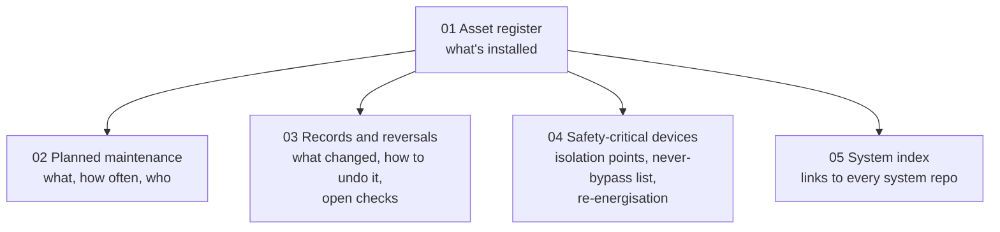

# Operations and Maintenance (O&M) Manual: The House as a Handover Pack (Design Stage)

**The house's building services documented as a BMS/M&E handover pack: an asset register, as-built and modification records, points schedules, sequences of operation, a planned maintenance schedule (boiler service, unvented cylinder checks, expansion vessels, controls batteries, ESP backups), safety-critical devices, and reversal procedures, structured the way a client receives a building at practical completion.**

> **The short version:**
> - **Asset register:** every plant item and controller with make/model, location (generic), install date, service interval.
> - **Records:** as-built and modification history (e.g. the Evohome installation and how to reverse it), with links to each system repo.
> - **Planned maintenance:** annual and periodic tasks with responsibilities (homeowner vs Gas Safe / G3-qualified engineer).
> - **Safety-critical list:** devices that must never be bypassed (cylinder high limits, relief valves, the fire/CO system).

**Portfolio position:** Management level · handover documentation. Indexes: [plant monitoring](https://github.com/the-control-cabinet/heating-plant-monitoring-esphome) · [Evohome](https://github.com/the-control-cabinet/evohome-heating-controls-ramses-integration) · [sequence of operation](https://github.com/the-control-cabinet/heating-sequence-of-operation) · [ESPHome fleet](https://github.com/the-control-cabinet/esphome-fleet-standards)

---

## Status at a glance

| Item | Status |
|---|---|
| Asset register (whole house, by system) | ✅ Populated ([data/asset-register.csv](data/asset-register.csv)) |
| Planned maintenance schedule | ✅ Written, 30+ tasks ([doc 02](docs/02-maintenance-schedule.md)) |
| Modification register M1-M7 with records and reversals | ✅ Written ([doc 03](docs/03-records-and-reversals.md)) |
| Open and closed checks from the heating-controls course | ✅ Tracked: 1 closed, 5 open (incl. boiler earth, bypass, slow leak) |
| Isolation points and devices never to be bypassed | ✅ Written ([doc 04](docs/04-safety-critical-devices-and-isolation.md)) |
| System index to every system repo | ✅ Written ([doc 05](docs/05-system-index.md)) |
| Circuit chart; first timed restore test | ⏳ To do |

## Why a handover pack for a house

At practical completion, a commercial client receives an O&M manual: what's installed, how it's maintained, what was changed and how to undo it, and what must never be bypassed. Most houses have none of that, which is how a boiler ends up with no automatic bypass and a supply flex with no earth core for years. This pack treats the house as a building with its own services and documents it the way a facilities manager would expect to receive it.

## How the pack is organised

## Modification register (summary)

| # | Modification | Date | Reversal documented |
|---|---|---|---|
| M1 | Evohome replaced the original controls | 2018 | ✅ Reversal procedure and commissioning tests |
| M2 | Immersion element controls removed, CS92 sensors fitted | 2018 | ✅ Immersion backup swap procedure |
| M3 | Non-invasive plant monitoring added | 2026 | ✅ Remove sensors |
| M4 | Junction box tidy-up (Wagos, opto board, labels) | Nov 2026 (planned) | ✅ Control wiring unchanged in function |
| M5 | OpenTherm control | Planned | ✅ Changeover to Mode A |
| M6 | Wi-Fi access points converted to AiMesh nodes | Nov 2026 | ✅ Per node: back to standalone from its recorded plan |
| M7 | RAMSES gateway auto-restart (software) | Nov 2026 | ✅ Disable the automation |

## Open checks (from a heating-controls wiring course, Oct 2026)

| # | Check | Status |
|---|---|---|
| 1 | Radiator zone valves in manual override: how far open? | ⏳ Open |
| 2 | Pump overrun / minimum-flow path: **no automatic bypass** found; the boiler manual requires one | ⚠️ Likely non-compliant: Gas Safe visit |
| 3 | Unvented cylinder high-limit cut-outs in series with each valve | ✅ Closed (verified on both) |
| 4 | **Boiler supply flex has no earth core** | ⏳ Open, high priority |
| 5 | Slow pressure leak on the sealed circuit (top-up about every two weeks) | ⏳ Open: Gas Safe visit |
| 6 | Cylinder panel cable earths cut at the junction box entry | ⏳ Open (tidy-up) |

## Maintenance highlights

| Task | Interval | Who |
|---|---|---|
| Boiler service + fault history read (look for L1) | Annual | Gas Safe engineer |
| Unvented cylinder inspection (relief valves, expansion vessels, high limits) | Annual | G3-qualified installer |
| RCD/RCBO test buttons | 6-monthly | Homeowner |
| EICR | 10 years / change of occupancy | Registered electrician |
| Smoke/CO alarm test; Aico interface function test | Monthly / annual | Homeowner |
| Danfoss TS715Si back on permanent ON (it still gates hot water) | After any power cut | Homeowner |
| **Disaster-recovery restore test** of the home automation head end | Annual | Homeowner |
| Router and access-point firmware | Quarterly | Homeowner |

The full schedule has 30+ tasks across heating, electrical, fire, security, water, energy and the head end.

## Never bypass

Cylinder overheat cut-outs and relief valves, the immersion's own element control when it's used, boiler internal limits, smoke/heat/CO alarms and their interface, and RCBOs. Isolation points for every kind of work (with the boiler RCBO as the only supply to the heating junction box) are in [doc 04](docs/04-safety-critical-devices-and-isolation.md).

## Documents

| Doc | Contents |
|---|---|
| [01 Asset register](docs/01-asset-register.md) | Plant and controls inventory |
| [02 Planned maintenance](docs/02-maintenance-schedule.md) | Tasks, intervals, who |
| [03 Records and reversals](docs/03-records-and-reversals.md) | Modification register with records and reversals; open and closed checks |
| [04 Safety-critical devices and isolation](docs/04-safety-critical-devices-and-isolation.md) | Isolation points (electrical, water, gas), devices never to be bypassed, re-energisation checks |
| [05 System index](docs/05-system-index.md) | Every building system and where it's documented |

## Roadmap
- [x] Asset register: whole house by system (first pass)
- [ ] Consumer unit circuit chart
- [ ] Maintenance schedule with dates
- [x] Every system linked from the [system index](docs/05-system-index.md)
- [ ] Annual review

## Skills demonstrated (as built)
| Skill | Evidence |
|---|---|
| Handover documentation | O&M structure as at practical completion |
| Asset management | Register with service intervals |
| Maintenance planning | PPM schedule with responsibilities |
| Change records | Modifications with reversal procedures |
| Safety management | Isolation points and a safety-critical device list from a site survey |

📺 [The Control Cabinet on YouTube](https://www.youtube.com/channel/UC5Cupmz7vlfcodpCX7k8iuQ)

*Built and documented by James · part of [The Control Cabinet BMS portfolio](https://github.com/the-control-cabinet/the-control-cabinet). MIT Licence.*
